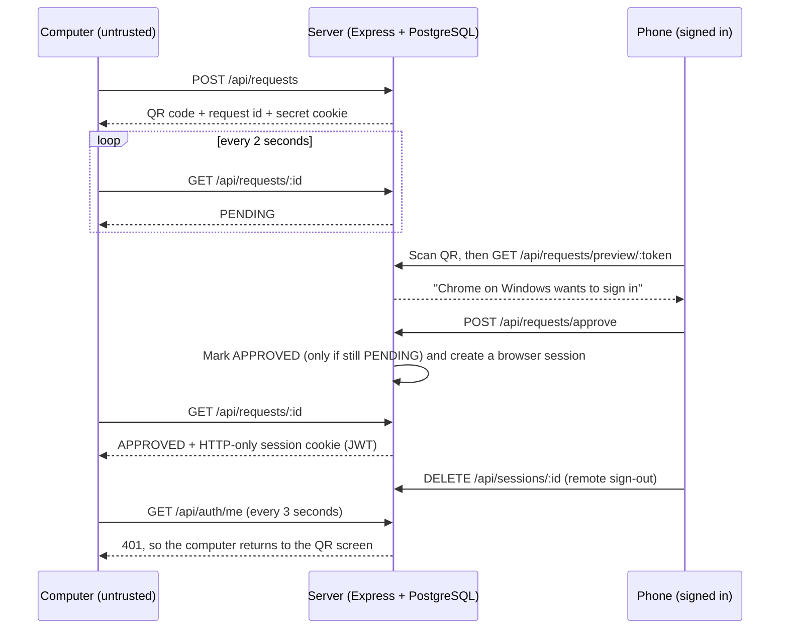
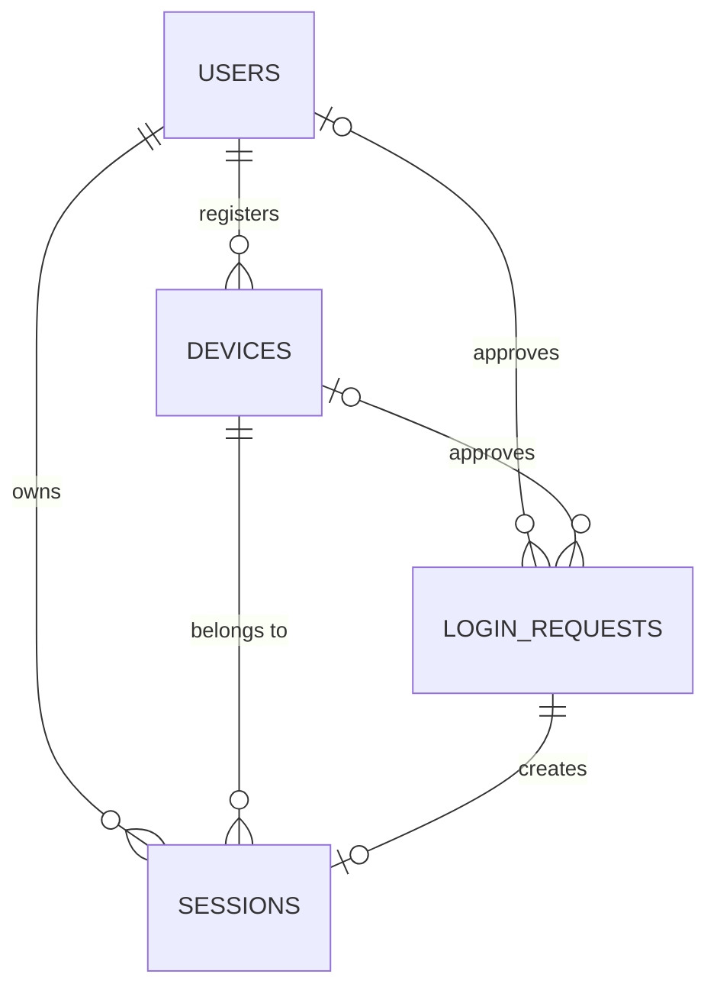

# QR Handoff

### Sign in on any computer without typing your password on it.


QR Handoff lets you sign in on a **shared or untrusted computer** (a library PC, a lab machine, a friend's laptop) by scanning a QR code with your **phone**. Your password is only ever typed on your own phone, and you can **sign the computer out from your phone** at any time.

---

## The problem

Every time you log in on a computer you don't own, you type your most valuable secret into a device you have no reason to trust:

- **Keyloggers and malware** can record what you type.
- **Browsers offer to save passwords**, and someone clicks "Save".
- **People forget to log out**, so the next person using the machine is effectively you.

Stolen credentials are consistently one of the most common ways attackers get into accounts. The root cause is simple: **the password is typed on a machine you don't control.**

## The solution

Remove the password from the untrusted computer entirely.

1. The computer shows a **one-time QR code**.
2. You scan it with your **phone**, which is already signed in.
3. The phone shows which browser is asking, and you tap **Approve**.
4. The computer is signed in within about 2 seconds.
5. Forgot to log out? Your phone lists every computer it approved, and **Sign out** kicks it out within about 3 seconds, no refresh needed.

If you've used WhatsApp Web, you already know the experience. This project builds that pattern from scratch as a general web-app login.

---

## How it works



---

## Features

| | Feature | Details |
|---|---|---|
| 📱 | **Password-free login on shared computers** | The computer never shows a password field. Laptops only get the QR screen. |
| ⏱️ | **Short-lived, single-use QR codes** | Each QR expires after 2 minutes and can be approved only once. |
| 👀 | **Approve with context** | The phone shows which browser is asking before you approve or deny. |
| 🔌 | **Remote sign-out** | The phone lists every approved computer and can sign any of them out. The computer notices within about 3 seconds. |
| 🔒 | **Revocable sessions** | JWTs point to a database session that is checked on every request, so signing out takes effect immediately. |
| 🧩 | **Simple, readable stack** | Plain HTTP polling, Express, Prisma and a no-framework frontend. |

---

## Security design

| Threat | How it's handled |
|---|---|
| Password captured on a shared computer | The password is never entered on the computer. |
| Someone reuses an old QR photo | QR tokens expire in **2 minutes** and are **single-use**: approval only updates a request that is still `PENDING`, so a second attempt changes 0 rows and gets `410 Gone`. |
| Two approvals at the same moment | The same conditional update is a single database statement, so only one approval can succeed, and a unique key allows only one session per request. |
| Someone polls a request id to steal the login | When the QR is created, that browser gets a secret cookie. Only the browser holding it can collect the session; anyone else gets `403`. |
| A computer approving other computers | Approval routes require a **phone** session (`requirePhone` middleware). |
| Session cookie stolen via JavaScript (XSS) | The cookie is `httpOnly`, so page scripts can't read it. |
| Cross-site request forgery | Cookies use `sameSite=lax`, and every state change is a `POST` or `DELETE`. |
| Database leak exposes passwords | Passwords are stored only as **bcrypt** hashes. |
| "JWTs can't be revoked" | Each JWT only carries a session id, and the middleware checks that session row in PostgreSQL on every request. |
| Prompt bombing ("MFA fatigue") | The user starts every approval by scanning a QR; the phone never receives an approval request it didn't ask for. |

**Known limitations** are listed in [Limitations and roadmap](#limitations-and-roadmap). QR relay phishing ("QRLJacking") is the main one, as it is for every QR login.

---

## Tech stack

| Layer | Technology | Role |
|---|---|---|
| Runtime | **Node.js 22** (ES Modules) | Runs the server |
| Web framework | **Express 5** | Routing, middleware, static files |
| Database | **PostgreSQL** | Users, devices, login requests, sessions |
| ORM | **Prisma 7** + `@prisma/adapter-pg` | Schema, migrations, type-safe queries |
| Auth | **jsonwebtoken**, **cookie-parser**, **bcryptjs** | Signed session tokens, cookies, password hashing |
| QR | **qrcode** | Generates the QR image |
| Frontend | **HTML, CSS, vanilla JavaScript** | One page for both the phone and computer views |
| Config | **dotenv** | Loads secrets from `.env` |

---

## Quick start

**You need:** Node.js 22.12+ and PostgreSQL 14+.

```bash
git clone https://github.com/AnjanaKamle/ItsMeAgain_AP_2026.git
cd ItsMeAgain_AP_2026
npm install
cp .env.example .env
```

Edit `.env` with your database URL and a random JWT secret (`openssl rand -hex 32`). Then create the database, tables and client, and start the server:

```bash
createdb sem3_capstone
npm run db:migrate
npm run db:generate
npm run dev
```

Open **http://localhost:3000**.

**To try it with a real phone:** open `http://<your-computer's-local-IP>:3000` on both the computer and the phone (same Wi-Fi). Create an account on the phone, click **Show sign-in QR** on the computer, and scan it.

| Script | Purpose |
|---|---|
| `npm run dev` | Start with auto-restart |
| `npm start` | Start normally |
| `npm run db:migrate` | Apply database migrations |
| `npm run db:generate` | Generate the Prisma Client |
| `npm run db:seed -- <phone> <password>` | Create a demo user |
| `npm run db:studio` | Browse the database in a web UI |

---

## Project structure

```text
├── src/
│   ├── server.js            # Starts the HTTP server, graceful shutdown
│   ├── app.js               # Express app and middleware
│   ├── db.js                # Shared Prisma client
│   ├── events.js            # EventEmitter: logs approvals
│   ├── routes/api.js        # All API routes
│   ├── controllers/         # Auth, QR login requests, sessions
│   ├── middleware/          # JWT cookie check, phone-only guard
│   └── services/            # Password hashing, session tokens
├── prisma/
│   ├── schema.prisma        # Data models
│   ├── migrations/          # SQL migrations
│   └── seed.js              # Demo user script
├── public/                  # Frontend: index.html, style.css, app.js
├── dbms/                    # Normalization, ER diagram, SQL schema and queries
└── .env.example             # Environment variable template
```

---

## API

| Method | Endpoint | Who | Purpose |
|---|---|---|---|
| `POST` | `/api/auth/register` | anyone | Create an account (phone) |
| `POST` | `/api/auth/login` | anyone | Sign in (phone) |
| `GET` | `/api/auth/me` | signed in | Current user and session type |
| `POST` | `/api/auth/logout` | signed in | Sign out this device |
| `POST` | `/api/requests` | computer | Create a QR login request |
| `GET` | `/api/requests/:id` | computer that created it | Poll status; receive session on approval |
| `GET` | `/api/requests/preview/:token` | phone | See which browser is asking |
| `POST` | `/api/requests/approve` | phone | Approve or deny |
| `GET` | `/api/sessions` | phone | List signed-in computers |
| `DELETE` | `/api/sessions/:id` | phone | Sign a computer out |

---

## Data model



- **users**: phone number (unique) and bcrypt password hash
- **devices**: phones a user has signed in on
- **login_requests**: one row per QR code, with token, expiry and status (`PENDING` / `APPROVED` / `DENIED`)
- **sessions**: signed-in phones and computers (`PHONE` / `BROWSER`), revoked by setting `revoked_at`

Full SQL schema, ER diagram and normalization notes are in [`dbms/`](dbms/).

---

## Limitations and roadmap

This is an academic project, not a production identity service.

| Limitation | Planned improvement |
|---|---|
| **QR relay phishing (QRLJacking):** an attacker can show a victim a real QR from their own session. | **Number matching** on both screens, or a proximity check (as passkeys do with Bluetooth). |
| The phone is trusted because its browser holds a session cookie. | Sign the QR token with a **hardware-backed key** on the phone (WebCrypto / Secure Enclave / Android Keystore). |
| Browser sessions last 7 days. | Shorter sessions for shared computers, plus an idle timeout. |
| Polling every 2 to 3 seconds. | WebSockets or Server-Sent Events for instant updates. |
| No phone-number verification, rate limiting or account recovery. | SMS/OTP verification, login rate limiting, backup codes. |
| HTTPS isn't enforced locally. | Run behind HTTPS; cookies get the `Secure` flag when `NODE_ENV=production`. |

---

## Team T0111

| Name | Role | GitHub |
|---|---|---|
| Aranav Chhabra | Group lead | [@Aranavchhabra](https://github.com/Aranavchhabra) |
| Parushya Data | Member | [@parushyadata](https://github.com/parushyadata) |
| Anjana Kamle | Member | [@AnjanaKamle](https://github.com/AnjanaKamle) |
| Sriharsha Mallavarapu | Member | [@user7217](https://github.com/user7217) |

Built for the Semester 3 Capstone: **Advanced Programming** (Node.js, Express, Prisma, authentication) and **Database Engineering** (PostgreSQL schema design, normalization, SQL).
